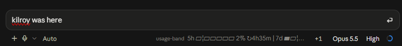

# burnline

A [Claude Code mod](https://code.claude.com/docs/en/plugins/mods/overview) that puts one quiet line next to the model selector, telling you how fast you're burning through your usage limits and how far Claude is through the current task.



The full line, when the window is wide enough:

```
burnline  5h ▰▰▰¦▱▱▱ 29% ↻4h10m | 7d ▰▰▰▰▰¦▱ 49% ↻1h | 8✓ ●●●◉○○○ +6 11/21
```

## What it shows

| Part | Meaning |
| --- | --- |
| `5h ▰▰▰▱▱▱ 29%` | How much of your 5-hour limit is used |
| `7d ▰▰▰▰▰▱ 49%` | How much of your weekly limit is used |
| `¦` | How much of that window's time has passed. If the bar fills past it, you're using the limit faster than it refills |
| `↻4h10m` | Time until that limit resets |
| `●●●◉○○○` | Claude's task list: done `●`, current `◉`, next `○`, up to seven around the current task |
| `8✓` / `+6` | Finished tasks before the dots / tasks after them |
| `11/21` | Tasks done out of the total |

The task part appears only while Claude has a task list, which it usually makes for multi-step goals. A finished list is cleared when you send your next prompt, so each new goal starts fresh.

The line refreshes after every reply, whenever a task changes, and once a minute so the countdowns keep moving.

## Install

In a Claude Code session:

```
/plugin install burnline --marketplace matrac/burnline
```

Answer `y` to add the marketplace, then pick a scope (user scope makes it run in every session).

## Requirements

- Claude Code **2.1.287 or later** (mods are on by default from that version).
- The usage bars need a **Claude subscription** (Pro or Max). With an API key there are no plan limits to show, so you'll only see the task dots.
- Shows in the **terminal** and the **desktop app's Code tab**. The VS Code panel doesn't draw mod output yet.

## Good to know

- The status line is plain text, so there are no colours. The bar characters are the whole design.
- Claude Code prints the mod's name (`burnline`) in front of the line. A mod can't remove that.
- In a narrow window, Claude Code cuts the line short with `…`.
- Per-model weekly limits (Opus vs Sonnet) aren't available to mods, so only the overall 5-hour and 7-day windows are shown.
- Tasks from subagents and teammates are ignored, so the dots follow the main conversation only.

## What it can reach

Mods run with your permissions, so here is the full list, as `claude plugin validate` reports it:

- **Calls:** the clock, your session's usage figures, the session's own saved values, and the status line.
- **Reads:** your 5-hour and 7-day usage percentages and reset times, and the names and status of Claude's tasks.
- **No** file access, network requests, programs started, or model calls. Nothing leaves your machine.

Check it yourself: `claude plugin validate <path to this repo>`.

## Develop

```
claude plugin validate .
claude plugin test .
```

The code is one file, [`hooks/register.ts`](hooks/register.ts).

## License

[MIT](LICENSE)
